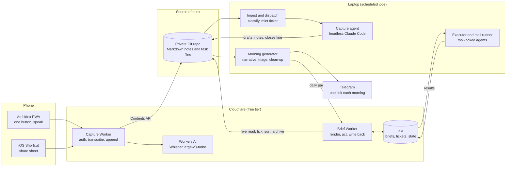
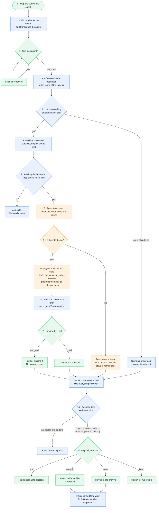

# Ambidex

A voice-first personal operating system, built with AI agents and run by them.

I speak a thought into my phone. A few seconds later it is a line in a Markdown file. A background agent then picks it up, works out what I meant, and does the first 80% of it: drafts the message, researches the question, files the note. Every morning a second system reads everything and gives me one page that says what matters today.

I use it every day. This repository documents how it is built.

> **Why there is no source code here.** Ambidex runs on my real tasks, inbox, contacts and notes, and its tests and history are full of them. The code lives in private repositories. This repo is the architecture, the design decisions and a few sanitised excerpts, which is the part worth reading anyway.

## The shape of it

Three loops share one store:

| Loop | What it does | Where it runs |
|---|---|---|
| **Capture** | Voice or share sheet to a task line, in seconds | Phone to Cloudflare Worker |
| **Act** | An agent reads each capture, classifies the intent, and produces a draft or a note for my review | Laptop, scheduled, headless Claude Code |
| **Review** | A daily page that surfaces what to do, what is going stale, and what the AI suggests pruning | Laptop generator plus Cloudflare Worker |

## Step by step: what happens to one thought

Follow a single capture from my voice to a finished task. Blue steps are automatic, orange steps are an AI agent working, green steps are me deciding.

The two rules that keep this safe:

- **An agent only acts when the intent is clear.** If it is not, the capture stays an ordinary task and waits for me.
- **An agent never completes the outward-facing step.** It drafts; sending, deleting and deciding stay with me.

## What makes it interesting

**1. A Markdown file is the database.** Tasks live as lines in a Markdown file in a private Git repository. The phone, the Workers and every agent read and write that one file through the GitHub Contents API. No app database, no sync layer, no lock-in. Git gives history, undo and an audit trail of every change an agent has ever made.

**2. The AI proposes, a human disposes.** Agents draft; they never send. The weekly clean-up assistant is read-only: it proposes "drop", "already done" or "file under objective X", and each proposal becomes a button I tap or dismiss. Nothing is deleted, ever. Completed and dropped tasks move to an archive and can be reopened.

**3. Model output is never trusted directly.** Every structured answer from a model is validated against the real data before it can reach a button: unknown ids, unknown actions and impossible combinations are discarded. A hallucinated task id cannot become a destructive action. See [patterns](docs/patterns.md).

**4. Each agent gets the smallest toolbox that does its job.** The executor that attempts tasks has a file-and-search allow-list and no shell. The mail triage agent has no tools at all and only writes text; a small API client does the I/O, and its send function requires an approval token that only a verified human tap can create. The guest agent runs in a copied directory that contains nothing personal.

**5. Everything fails soft.** If the model times out, the brief still renders from the last good pass. If a data source is unreachable, that section is omitted and the rest ships. A missing age is treated as "unknown", never guessed as "stale".

**6. It costs nothing to run.** Cloudflare free tier for compute, storage and speech-to-text. Agent work runs through headless Claude Code on a flat subscription, so there is no per-call API bill. The brief shows what the same usage would have cost at API list prices.

## Components

| Component | Stack | Role |
|---|---|---|
| Ambidex PWA | Single HTML file, vanilla JS, `MediaRecorder`, Web Audio | One-button voice capture with live waveform, type-instead fallback, photo attach |
| Capture Worker | TypeScript, Cloudflare Workers, Workers AI | Auth, transcription, append to the Inbox with retry on write conflicts |
| Ingest and dispatch | Python, launchd | Classifies each capture, mints a ticket with a stable id, queues it for an agent |
| Capture agent | Headless Claude Code driven by a skill file | More than a dozen intents, including outreach draft, people sourcing, research note, quick lookup, link gist, brain-dump to note, calendar entry and email draft |
| Morning generator | TypeScript on Node, launchd | Reads notes, tasks and agent transcripts; writes the narrative; triages; runs the weekly clean-up pass |
| Brief Worker | TypeScript, Cloudflare Workers, KV | Renders the page, reads the task file live, writes ticks, sorts, drops, reopens and archives |
| Executor and mail runner | TypeScript, headless Claude Code, launchd | Drains tickets opened from the page, under tool allow-lists |

## Read more

- [Architecture](docs/architecture.md): data flows, the ticket lifecycle, the review logic
- [Design decisions](docs/design-decisions.md): the choices that held, and the ones that were wrong
- [Patterns](docs/patterns.md): sanitised code excerpts for the ideas above
- [How it was built](docs/how-it-was-built.md): the spec-first, agent-built workflow behind it

## Numbers

| | |
|---|---|
| Automated tests | 368 on the brief, 92 on the capture Worker, 47 on ingest and dispatch |
| Running cost | Zero infrastructure, one flat AI subscription |
| Time from speaking to a saved task | Seconds |
| Built | August to October 2026, alongside a full-time MBA |

## About

Built by [Arthur Maroquene Froissart](https://www.linkedin.com/in/arthurmf/). Six years in enterprise software at Salesforce and MuleSoft, now an INSEAD MBA building with AI. The planning and build workflow used here is open in [claude-skills](https://github.com/Arthurmf01/claude-skills).
