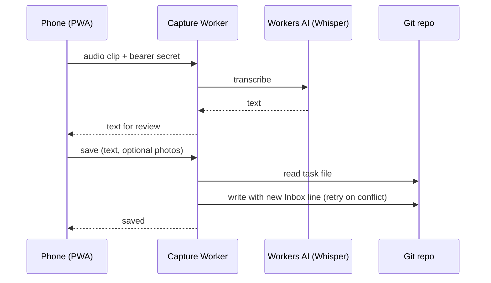
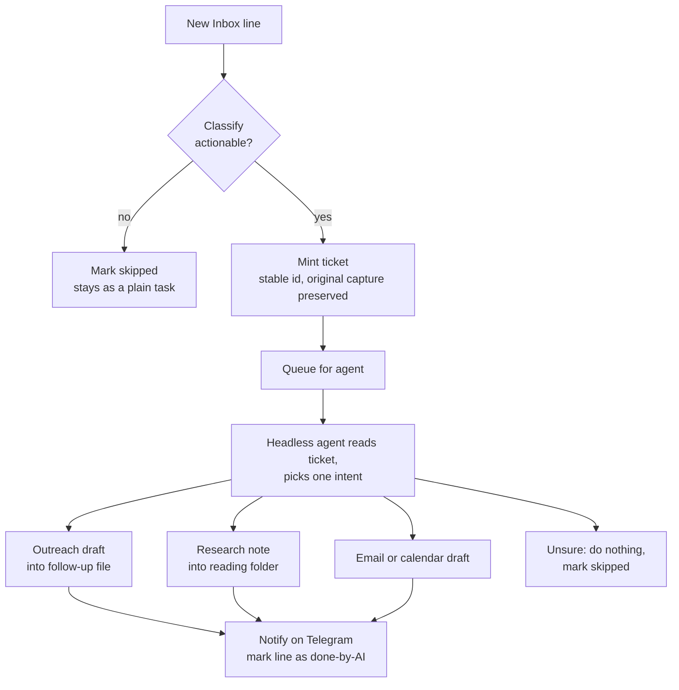
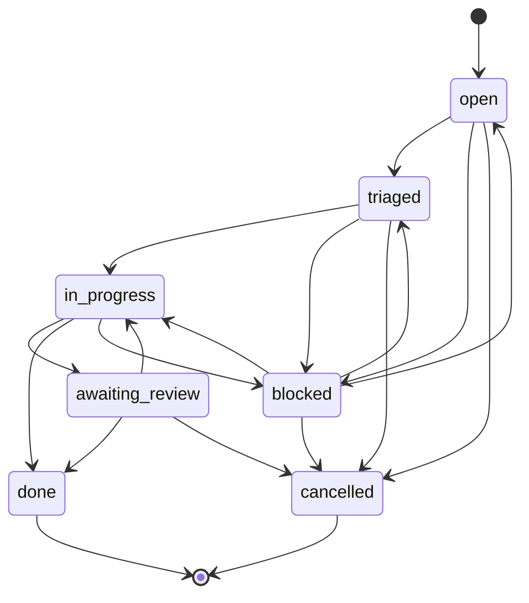
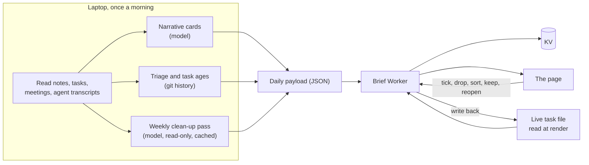

# Architecture

## One store, many writers

Everything hangs off one private Git repository of Markdown notes. Two files matter most:

- **The task file.** One line per task, grouped by area. A sorted task carries a stable id, a life objective and an urgency flag. An unsorted capture sits in an Inbox section.
- **The follow-up file.** One entry per person I am waiting on or need to nudge, with a drafted message.

A third file, the **archive**, receives every completed or dropped task under a dated heading.

Writers are the phone (through the capture Worker), the brief page (through the brief Worker), the background agents, and me in a text editor. They coordinate through three rules:

1. **Read immediately before writing.** Every write path fetches the current file, applies a pure string transform, and writes back with the file's version hash. A conflict triggers a re-read and retry.
2. **Archive first.** When a task is completed, the line is appended to the archive before it is removed from the task file. A crash between the two steps leaves a duplicate, never a loss.
3. **Idempotent actions.** Completing a task that is already archived is a success, not an error, so a double tap or a retry is harmless.

## Capture path

Design notes:

- **PWA, not a native app.** Installs to the home screen, costs nothing, needs no developer account. The one thing a PWA cannot do on iOS is receive from the share sheet, so that single job belongs to an iOS Shortcut that posts to the same endpoint.
- **Record in the browser, transcribe on the server.** iOS Safari has no live speech recognition but does record audio. The clip is transcribed by Whisper on Workers AI, inside the same Worker, on the free tier.
- **The server never guesses.** The capture path appends a raw line to the Inbox. It does not assign urgency, area or objective. Triage is a separate, later step.

## Act path: from capture to ticket to agent

Each ticket is a Markdown file with front matter (id, handle, status, timestamps) and a body that keeps the original capture verbatim. The agent reads the ticket, not the task line, because the line gets rewritten as it is tidied and the original wording would be lost.

### Ticket lifecycle

One table defines every legal move. Done and cancelled are terminal.

A lesson built into this path: a ticket is only moved to "in progress" when a worker has actually taken it. An earlier version marked captures as in progress at ingest, with no worker attached, and the agent (which only collects queued lines) never saw them. Reading-list captures silently disappeared for weeks. State must describe what is true, not what is intended.

## Review path: the morning brief

The split is by where the data lives. Only the laptop can read local notes and agent transcripts, so the AI-written parts are generated once a day and served from a snapshot. The task list is the exception: the Worker reads it live at render and merges it onto the snapshot, so a capture made at noon is on the page at noon, and ticking a task works with the laptop asleep.

### "Needs a decision"

The problem this solves: capturing is easy, so the list grows, and things get lost in it. The page surfaces the tasks most likely to be lost, in three groups.

| Group | Rule |
|---|---|
| **Unsorted** | An open capture with no life objective. The daily shortlist skips the Inbox, so these never surface on their own. |
| **Stale** | A sorted task open for longer than its own urgency flag promises. A "this week" task still open after a week has an out-of-date flag. |
| **Suggested clean-up** | The model's weekly proposals: drop, already done, or file under an objective. Each is one tap to accept or dismiss. |

Task ages come from the Git history of the task file: the date a task first appeared, and the date its urgency flag last changed. If the age is unknown, the task is not called stale.

Every decision is reversible. "Keep" snoozes a task for two weeks. "Won't do" moves it to the archive marked as dropped. The Done view shows the last thirty days of completed and dropped tasks and can reopen any of them.

## Scheduled agents

| Job | Cadence | Tools it may use |
|---|---|---|
| Capture agent | Every couple of minutes, only when the queue is non-empty | Governed by a skill file: draft only, three writable locations, do nothing when unsure |
| Guest agent | With the capture agent, when a guest queue exists | Runs inside a copied folder of shared course notes; nothing personal is on its path |
| Morning generator | Once a day | Text in, text out |
| Task executor | Polls for pending tickets | Read, write, edit, search, web; no shell |
| Mail triage | Polls for requests from the page | No tools; an API client drafts and labels, and sends only with a human approval token |

A cheap pre-check runs before any model call: if nothing is queued, the job exits without spending a token.
