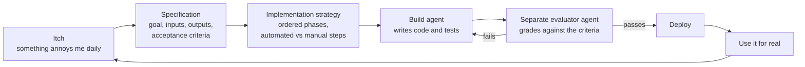

# How it was built

Ambidex is written almost entirely by AI coding agents, working to specifications I write and review. I act as product owner, architect and reviewer. The method matters more than the code, so here it is.

## The loop

1. **Specification first.** Every version starts as a short document: what it is for, what goes in and out, and numbered acceptance criteria. Nothing is built without one.
2. **A separate evaluator.** The agent that writes the code does not grade it. A second agent checks the result against the acceptance criteria. An agent marking its own work passes too easily.
3. **Small versions.** More than a dozen numbered versions of each half, each shippable on its own, each with its own specification kept in the repo as the record of why.
4. **Decisions are written down.** A running decisions file records every non-obvious call and its reasoning, so a later session (human or agent) does not relitigate it.
5. **Use it, then fix what hurts.** Most versions came from a concrete daily irritation, not a roadmap.

The planning and build skills behind this loop are open: [claude-skills](https://github.com/Arthurmf01/claude-skills).

## What I learnt about building with agents

- **The specification is the product.** A vague request produces plausible code that solves the wrong problem. Time spent on acceptance criteria is repaid many times.
- **Tests are how you trust code you did not type.** Every file transform is a pure function with tests, so I can review behaviour instead of reading every line.
- **Agents are confident when wrong.** A background agent once closed a "verify this fact" capture with a firm, incorrect answer. The system now treats agent output as a draft for review, and "do nothing when unsure" is the first rule in the agent's instructions.
- **Verify on the real thing.** Several changes passed every test and still failed on the phone. A feature is done when it has been checked where it is used.
- **Report what happened, not what was meant to.** The most damaging bugs here were silent ones where the state said "in progress" and nothing was happening.

## Version history, briefly

| Stage | What changed |
|---|---|
| Capture v1 to v3 | Share-sheet capture, then the one-button voice app, then back-to-back captures and photos |
| Capture v4 to v9 | A background agent that starts the task: outreach drafts first, then research, lookups, link gists, structured notes |
| Capture v10 to v13 | Mail and calendar drafting, faster transcription, a reskin, install-once sign-in |
| Ticketing | Every actionable capture becomes a ticket with a stable id and a defined lifecycle |
| Brief v1 to v5 | A morning page with AI narrative and a cost panel, then live task reads and writes, then an archive |
| Brief v6 to v13 | Phone-first layout, priorities, a tickets tracker, a mail review tab, tool-locked executors |
| Review | The "needs a decision" block, a dropped state, the Done view, and the read-only clean-up assistant |
